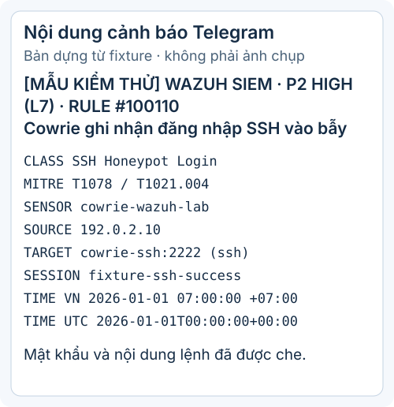

# Cowrie–Wazuh Telegram Toolkit

Bẫy SSH, phân tích sự kiện bằng Wazuh SIEM và cảnh báo qua Telegram trên một VM Ubuntu Server.

[Tải v0.1.1](https://github.com/phTrKi3n/honeypot-wazuh-telegram/releases/tag/v0.1.1) · [Cài đặt](#cài-đặt) · [Nghiệm thu](#nghiệm-thu) · [Xử lý sự cố](#xử-lý-sự-cố) · [MIT](LICENSE)

**Phạm vi:** lab phòng thủ một VM Ubuntu Server 24.04, có mạng Host-only mô phỏng WAN và card NAT ra Internet. Cowrie và SIEM cùng dùng kernel; cấu hình này dành cho thực hành trong mạng lab do bạn sở hữu.

## Bạn nhận được gì

Cowrie ghi nhận tương tác SSH. Wazuh phân tích log từ bẫy và bộ tương quan firewall, rồi gửi bản tin HTML tới chat Telegram đã cấu hình. Wazuh Dashboard dùng để tra cứu chi tiết.



*Bản dựng nội dung từ [fixture SSH](wazuh/fixtures/telegram-alerts.ndjson) và formatter của toolkit. Đây là dữ liệu kiểm thử, không phải ảnh chụp Telegram. Mật khẩu, lệnh và URL tải tệp được loại khỏi bản tin.*

| Rule | Cảnh báo |
|---|---|
| `100110` | Đăng nhập SSH thành công vào bẫy |
| `100112` | 5 lần đăng nhập SSH thất bại cùng nguồn trong 60 giây |
| `100115` | Lệnh hoặc hoạt động tải tệp trong shell giả lập |
| `100120` | Ít nhất 5 cổng đích khác nhau bị chặn từ cùng nguồn trong 30 giây |

Bot hiện gửi cảnh báo tự động. Thư mục `ui/` là trang minh họa với dữ liệu cố định. Phần dò nhiều cổng theo dõi card lab đã cấu hình; các kết nối tới mạng khác của máy chủ không thuộc luồng này.

## Kiến trúc


Hai nguồn phát hiện cùng đi vào Wazuh: log JSON của Cowrie và sự kiện được tổng hợp từ `LAB_WAN_BLOCK`. Manager áp quy tắc, chuyển cảnh báo cho Indexer và gọi tích hợp Telegram. Mũi tên chỉ chiều dữ liệu; đường viền nét đứt là ranh giới VM. Các quan hệ đã được đối chiếu trong source và xuất bằng Graphify; hình SVG được bố trí lại để đọc trên GitHub.

## Trước khi bắt đầu

Chuẩn bị Ubuntu Server 24.04 LTS x86-64, **4 vCPU, 8 GiB RAM, đĩa 70 GB**, kết nối Internet và một Telegram bot. Cấu hình lab đã được kiểm với Cowrie 3.1.6 và Wazuh 4.14.10.

| Thành phần | Giá trị mẫu |
|---|---|
| NAT ra Internet | `ens33`, DHCP IPv4 và default gateway |
| Host-only cho lab | `ens37`, `192.168.100.20/24` |
| Windows quản trị | `192.168.100.1/24`, adapter Host-only không có gateway |
| Cowrie SSH | `192.168.100.20:2222` |
| Wazuh Dashboard | `https://192.168.100.20` |
| Wazuh API và Indexer | Chỉ lắng nghe trên localhost |

> [!WARNING]
> Dùng VM chuyên dụng và chụp snapshot trước khi cấu hình mạng. Thực hiện bước firewall qua **console VM**. Ruleset mẫu thay toàn bộ luật nftables hiện có và chặn cổng OpenSSH quản trị; phiên SSH quản trị có thể bị ngắt.

<details>
<summary>Tên card hoặc subnet của bạn khác cấu hình mẫu?</summary>

Dùng `ip -br addr` và `ip route` để xác định card NAT, Host-only và default gateway. Tên card phụ thuộc phần mềm ảo hóa. Giữ DHCP cho card NAT trong cấu hình Ubuntu.

Khi đổi subnet hoặc tên card, sửa đồng thời:

- `infra/90-cowrie-lab.yaml` — IP của card Host-only.
- `infra/nftables.conf` — tên card, IP quản trị, subnet và IP VM.
- `cowrie/cowrie.cfg` — địa chỉ lắng nghe SSH.
- `wazuh/firewall/firewall.py` — tên card và IP đích cần theo dõi.
- `/etc/wazuh-dashboard/opensearch_dashboards.yml` — địa chỉ bind Dashboard.
- `/var/ossec/etc/cowrie-telegram.json` — `dashboard_url` hiển thị trong Telegram.

`dashboard_url` là tùy chọn và chỉ nhận URL HTTPS. Nếu bỏ trường này, bản tin không chèn liên kết Dashboard.

</details>

## Tải bộ công cụ

Cài gói hệ thống trước:

```sh
sudo apt-get update
sudo apt-get install -y curl ca-certificates python3-venv nftables openssl
```

**Archive:** tải `cowrie-wazuh-telegram-v0.1.1.tar.gz` và `SHA256SUMS` từ [Release v0.1.1](https://github.com/phTrKi3n/honeypot-wazuh-telegram/releases/tag/v0.1.1) vào cùng thư mục.

```sh
sha256sum --ignore-missing -c SHA256SUMS
tar -xzf cowrie-wazuh-telegram-v0.1.1.tar.gz
cd cowrie-wazuh-telegram-v0.1.1
```

Chỉ giải nén và dùng gói khi lệnh checksum trả `OK` cho đúng archive vừa tải.

<details>
<summary>Hoặc clone bằng Git</summary>

```sh
sudo apt-get install -y git
git clone --branch v0.1.1 --depth 1 https://github.com/phTrKi3n/honeypot-wazuh-telegram.git
cd honeypot-wazuh-telegram
```

</details>

## Cài đặt

Cài lần lượt năm phần dưới đây từ thư mục toolkit. Mỗi mục có lệnh kiểm để xác nhận trước khi chuyển bước.

### 1. Mạng và firewall

> [!CAUTION]
> Mở console VM, kiểm tên card và snapshot trước khi chạy. Chỉ áp các lệnh này sau khi đã sửa giá trị mẫu cho đúng mạng của bạn.

<details>
<summary>1a. Đặt IP Host-only và tạo tài khoản chạy Cowrie</summary>

```sh
sudo install -m 0600 infra/90-cowrie-lab.yaml /etc/netplan/90-cowrie-lab.yaml
sudo netplan try
ip -4 route show default
getent passwd cowrie >/dev/null ||
  sudo useradd --system --user-group --home-dir /var/lib/cowrie --shell /usr/sbin/nologin cowrie
sudo install -d -o cowrie -g cowrie -m 0750 /var/lib/cowrie
```

Xác nhận `ip -br addr` có IP Host-only đúng và default route vẫn đi qua card NAT. `netplan try` cho phép hoàn tác nếu bạn không xác nhận thay đổi.

</details>

<details>
<summary>1b. Render UID, kiểm và áp nftables</summary>

```sh
cowrie_uid=$(id -u cowrie) || exit 1
rendered=$(mktemp) || exit 1
trap 'rm -f "$rendered"' EXIT
sed "s/@COWRIE_UID@/$cowrie_uid/g" infra/nftables.conf > "$rendered" || exit 1
sudo nft -c -f "$rendered" || exit 1
sudo cp -an /etc/nftables.conf /etc/nftables.conf.before-cowrie
sudo install -m 0755 "$rendered" /etc/nftables.conf
sudo systemctl enable nftables
sudo systemctl restart nftables
```

`nft -c` phải thành công trước khi áp luật. Kiểm lại bằng `sudo nft list ruleset`. UID Cowrie chỉ được trả lời phiên SSH đã cho phép; kết nối mới do UID này khởi tạo, gồm NAT, loopback và IPv6, bị chặn.

</details>

<details>
<summary>1c. Tắt chuyển tiếp IP</summary>

```sh
printf '%s\n' 'net.ipv4.ip_forward = 0' 'net.ipv6.conf.all.forwarding = 0' |
  sudo tee /etc/sysctl.d/90-cowrie-lab.conf >/dev/null
sudo sysctl -p /etc/sysctl.d/90-cowrie-lab.conf
```

Cả hai giá trị phải bằng `0`. VM không đóng vai trò router của mạng gia đình.

</details>

### 2. Cowrie

<details>
<summary>Cài Cowrie 3.1.6 và bật dịch vụ</summary>

```sh
sudo python3 -m venv /opt/cowrie/venv
sudo /opt/cowrie/venv/bin/pip install 'cowrie==3.1.6'
(cd /var/lib/cowrie && sudo -u cowrie /opt/cowrie/venv/bin/cowrie init)
sudo install -o root -g cowrie -m 0640 cowrie/cowrie.cfg /var/lib/cowrie/etc/cowrie.cfg
sudo bash -euc '
  f=/var/lib/cowrie/etc/userdb.txt
  if [ ! -f "$f" ]; then
    umask 077
    printf "labdemo:x:%s\n" "$(openssl rand -hex 16)" > "$f"
  fi
  chown root:cowrie "$f"
  chmod 0640 "$f"
'
sudo install -m 0644 cowrie/cowrie-lab.service /etc/systemd/system/cowrie-lab.service
sudo systemctl daemon-reload
sudo systemctl enable --now cowrie-lab
```

</details>

Kiểm bằng `sudo systemctl is-active cowrie-lab` và `sudo ss -ltn 'sport = :2222'`. Cowrie phải chạy và lắng nghe tại IP Host-only. Tài khoản quản trị dùng quyền root xem `/var/lib/cowrie/etc/userdb.txt` để đăng nhập thử; giữ mật khẩu bẫy ngoài Git và ảnh báo cáo.

### 3. Wazuh SIEM

Đã kiểm với Wazuh 4.14.10. URL installer thuộc dòng 4.14 và có thể phục vụ bản vá mới hơn; kiểm phiên bản sau cài và chạy lại nghiệm thu. Xem [Wazuh Quickstart](https://documentation.wazuh.com/current/quickstart.html) cho yêu cầu upstream.

<details>
<summary>Cài Wazuh và giới hạn địa chỉ lắng nghe</summary>

```sh
sudo install -d -m 0700 /root/wazuh-setup
sudo curl --fail --show-error --location \
  https://packages.wazuh.com/4.14/wazuh-install.sh \
  -o /root/wazuh-setup/wazuh-install.sh
sudo bash -c 'cd /root/wazuh-setup && bash wazuh-install.sh -a'
dpkg-query -W wazuh-manager wazuh-indexer wazuh-dashboard filebeat
```

Giữ gói tài khoản installer tạo trong `/root/wazuh-setup`, ngoài repo. Sau đó cấu hình:

| File trên Ubuntu | Giá trị |
|---|---|
| `/var/ossec/api/configuration/api.yaml` | `host: ['127.0.0.1']` |
| `/etc/wazuh-indexer/opensearch.yml` | `network.host: "127.0.0.1"` |
| `/etc/wazuh-dashboard/opensearch_dashboards.yml` | `server.host: 192.168.100.20` |

```sh
sudo install -d -m 0755 /etc/systemd/system/wazuh-dashboard.service.d
printf '[Unit]\nWants=network-online.target\nAfter=network-online.target\n' |
  sudo tee /etc/systemd/system/wazuh-dashboard.service.d/network.conf >/dev/null
```

</details>

Kiểm phiên bản bằng `dpkg-query` ở trên. Sau bước 4, kiểm `ss -ltn`: API và Indexer chỉ ở localhost, Dashboard ở IP Host-only. Dashboard dùng chứng chỉ do installer tạo; cấu hình chứng chỉ phù hợp địa chỉ truy cập khi chia sẻ lab cho người khác.

### 4. Thu log và áp rule

<details>
<summary>Cài bộ gom firewall, rule và hai nguồn log</summary>

```sh
sudo install -d -m 0755 /usr/local/lib/cowrie-lab
sudo install -m 0644 wazuh/firewall/firewall.py /usr/local/lib/cowrie-lab/firewall.py
sudo install -d -m 0750 /var/log/cowrie-lab
sudo touch /var/log/cowrie-lab/firewall.json
sudo chmod 0640 /var/log/cowrie-lab/firewall.json
sudo install -m 0644 wazuh/firewall/cowrie-firewall-events.service \
  /etc/systemd/system/cowrie-firewall-events.service
sudo install -o root -g wazuh -m 0640 wazuh/rules/cowrie_lab.xml \
  /var/ossec/etc/rules/cowrie_lab.xml
sudo cp -an /var/ossec/etc/ossec.conf /var/ossec/etc/ossec.conf.before-cowrie
```

Mở `/var/ossec/etc/ossec.conf`. Chèn hai khối dưới đây **bên trong** một khối `ossec_config` hiện có. Mỗi đường dẫn chỉ xuất hiện một lần; không chép thêm lớp bọc `ossec_config` từ file mẫu.

```xml
<localfile>
  <log_format>json</log_format>
  <location>/var/lib/cowrie/var/log/cowrie/cowrie.json</location>
</localfile>
<localfile>
  <log_format>json</log_format>
  <location>/var/log/cowrie-lab/firewall.json</location>
</localfile>
```

```sh
sudo /var/ossec/bin/wazuh-analysisd -t
sudo /var/ossec/bin/wazuh-logcollector -t
sudo systemctl daemon-reload
sudo systemctl enable --now cowrie-firewall-events
sudo systemctl restart wazuh-manager wazuh-indexer wazuh-dashboard
```

</details>

Hai lệnh `-t` phải thành công; `cowrie-firewall-events` phải active. Khi xoay `firewall.json` bằng cách đổi tên file, khởi động lại bộ gom để mở file mới.

### 5. Telegram

1. Tạo bot qua [BotFather](https://t.me/BotFather), lấy token, mở chat với bot và gửi `/start`.
2. Lấy trường `message.chat.id` từ [Telegram getUpdates](https://core.telegram.org/bots/api#getupdates).
3. Tạo cấu hình trên Ubuntu, giữ token và chat ID trong file cục bộ có quyền hạn chế.

<details>
<summary>Cấu hình bot và tích hợp Wazuh</summary>

```sh
sudo test -f /var/ossec/etc/cowrie-telegram.json ||
  sudo install -o root -g wazuh -m 0640 wazuh/telegram/config.example.json \
    /var/ossec/etc/cowrie-telegram.json
sudo nano /var/ossec/etc/cowrie-telegram.json
sudo chown root:wazuh /var/ossec/etc/cowrie-telegram.json
sudo chmod 0640 /var/ossec/etc/cowrie-telegram.json
sudo install -o root -g wazuh -m 0750 wazuh/telegram/custom-cowrie-telegram \
  /var/ossec/integrations/custom-cowrie-telegram
```

Điền `bot_token`, `chat_id` và, nếu muốn, `dashboard_url` là URL HTTPS của Dashboard, không chứa tài khoản, query hoặc fragment. Bỏ `dashboard_url` nếu không muốn gửi liên kết. URL sai làm lần gửi thất bại và ghi lỗi vào journal. Không dán token vào issue, commit hoặc ảnh chụp.

Chèn một khối dưới đây vào bên trong `ossec_config` hiện có ở `/var/ossec/etc/ossec.conf`:

```xml
<integration>
  <name>custom-cowrie-telegram</name>
  <rule_id>100110,100112,100115,100120</rule_id>
  <alert_format>json</alert_format>
</integration>
```

```sh
sudo /var/ossec/bin/wazuh-integratord -t
sudo systemctl restart wazuh-manager
sudo /var/ossec/bin/wazuh-control status
sudo journalctl -t cowrie-telegram -o cat
```

</details>

`wazuh-integratord -t` phải thành công. Bot chỉ gửi khi có sự kiện khớp rule; gửi `/start` cho bot không tự tạo cảnh báo của lab.

## Nghiệm thu

Chạy kiểm tra cục bộ và trạng thái dịch vụ:

```sh
python3 wazuh/telegram/test_telegram.py
python3 docker/test_entrypoint.py
python3 wazuh/firewall/firewall.py --check
sudo systemctl is-active nftables cowrie-lab cowrie-firewall-events \
  wazuh-manager wazuh-indexer wazuh-dashboard filebeat
timedatectl show -p NTPSynchronized
sudo ss -ltn
```

Các test phải đạt, dịch vụ phải active và đồng hồ phải được đồng bộ trước khi đo độ trễ từ timestamp nguồn.

Từ máy khách trong mạng lab do bạn sở hữu, đăng nhập SSH tới IP Host-only của VM, cổng `2222`, bằng tài khoản bẫy. Đối chiếu mã phiên trên cả ba nơi:

| Dữ liệu | Vị trí trên Ubuntu |
|---|---|
| Cowrie JSON | `/var/lib/cowrie/var/log/cowrie/cowrie.json` |
| Firewall tổng hợp | `/var/log/cowrie-lab/firewall.json` |
| Cảnh báo Wazuh | `/var/ossec/logs/alerts/alerts.json` |
| Kết quả gửi Telegram | `journalctl -t cowrie-telegram` |

Một kết nối bị chặn có thể tạo `LAB_WAN_BLOCK`. Rule `100120` chỉ báo khi bộ tương quan thấy ít nhất 5 cổng đích khác nhau trong 30 giây. Dùng [fixtures](wazuh/fixtures) cho ca biên; sự kiện thử gửi Telegram cần có `fixture: true` để hiện `[MẪU KIỂM THỬ]`.

Độ trễ gửi được ghi tới thời điểm Bot API trả `ok`; mốc này khác thời điểm điện thoại hiển thị tin. Log Cowrie/Wazuh nội bộ có thể chứa dữ liệu đã nhập vào bẫy: giới hạn quyền đọc, thời gian lưu và chỉ dùng tài khoản thử riêng.

## Xử lý sự cố

| Triệu chứng | Kiểm tra |
|---|---|
| Cowrie không chạy | `sudo journalctl -u cowrie-lab -n 50`; đối chiếu IP bind và quyền file cấu hình |
| Không thấy log firewall | `sudo journalctl -k -g LAB_WAN_BLOCK`; kiểm tên card/IP trong nftables và `firewall.py` |
| Log có nhưng Wazuh không báo | Kiểm hai `localfile`, rule và kết quả `wazuh-analysisd -t`, `wazuh-logcollector -t` |
| Telegram không có tin | Kiểm `wazuh-integratord -t`, `journalctl -t cowrie-telegram`, token/chat ID và `/start` |
| Tin báo thiếu link Dashboard | Thêm hoặc sửa `dashboard_url` HTTPS trong file cấu hình bot |
| Gửi thất bại / HTTP 429 | Giảm nhịp demo, xem journal; đọc giới hạn thử lại bên dưới |
| Mất SSH quản trị sau áp luật | Quay lại console VM; luật mẫu chỉ cho SSH bẫy và Dashboard theo IP lab |

## Khôi phục cấu hình

Các lệnh cài đã giữ bản sao `.before-cowrie` khi file gốc tồn tại. Để quay lui toàn bộ lab, dùng snapshot đã chụp trước cài. Để sửa riêng firewall hoặc Wazuh, thao tác qua console và kiểm nội dung backup trước:

```sh
sudo nft -c -f /etc/nftables.conf.before-cowrie || exit 1
sudo cp -a /etc/nftables.conf.before-cowrie /etc/nftables.conf
sudo systemctl restart nftables
```

Chỉ chạy nếu backup là cấu hình trước cài mà bạn muốn phục hồi. Nếu quay lui Wazuh, khôi phục `/var/ossec/etc/ossec.conf.before-cowrie`, bỏ rule bổ sung cùng cấu hình tích hợp tương ứng rồi chạy lại các lệnh `-t` trước khi restart. Dùng snapshot khi không chắc các thay đổi phụ thuộc; không flush firewall đang bảo vệ bẫy để thử kết nối.

## Kiểm thử offline bằng Docker

<details>
<summary>Chạy bộ tương quan và định dạng bản tin bằng fixture</summary>

Chuẩn bị Docker cùng Compose plugin, rồi chạy tại thư mục toolkit:

```sh
docker compose -f docker/compose.yaml up --build \
  --abort-on-container-exit --exit-code-from soc-detector
```

Container dùng UID thấp, filesystem chỉ đọc, bỏ capabilities và tắt mạng. Self-test yêu cầu đủ fixture và bốn loại rule, thiếu đầu vào phải trả exit code khác `0`. Output thành công có bốn dòng `SOC ALERT` và mẫu tương quan firewall. Docker ở đây kiểm logic bằng dữ liệu mẫu; Wazuh/Cowrie thực chạy theo phần cài Ubuntu ở trên.

</details>

## Phạm vi và giới hạn

- Phiên SSH thật, chặn mạng, rule Wazuh và gửi Telegram đã được kiểm trên cấu hình lab nêu trên. Phần dò nhiều cổng được kiểm bằng log tổng hợp và fixture. Cài lên VM mới cần chạy lại nghiệm thu.
- Cowrie và Wazuh dùng chung kernel. Giữ mạng lab cô lập, Dashboard ở mạng quản trị, API và Indexer trên localhost; Cowrie bị chặn kết nối mới ra ngoài.
- Khi Telegram trả HTTP 429, notifier chỉ thử lại trong giới hạn cho phép của `retry_after`: tối đa 3 lần gửi, mỗi lần chờ tối đa 5 giây. Lỗi timeout/5xx không tự thử lại để tránh gửi trùng khi kết quả chưa rõ. Đây không phải hàng đợi bền vững; sự cố mạng hoặc hết giới hạn vẫn có thể làm lần gửi thất bại. Xem lại cảnh báo trong Wazuh.
- Token, mật khẩu, khóa riêng, log thô và ảnh đĩa VM phải nằm ngoài repo. Chỉ đăng dữ liệu mẫu có nhãn hoặc ảnh đã che thông tin nhạy cảm.

Các thư mục tùy chỉnh là `infra/`, `cowrie/`, `wazuh/` và `docker/`. Phần `ui/` là demo dữ liệu cố định, không dùng làm bằng chứng hệ thống đang hoạt động.

## Giấy phép

Mã của toolkit được phát hành theo [MIT License](LICENSE). Cowrie, Wazuh và các phụ thuộc giữ giấy phép riêng của từng dự án.
