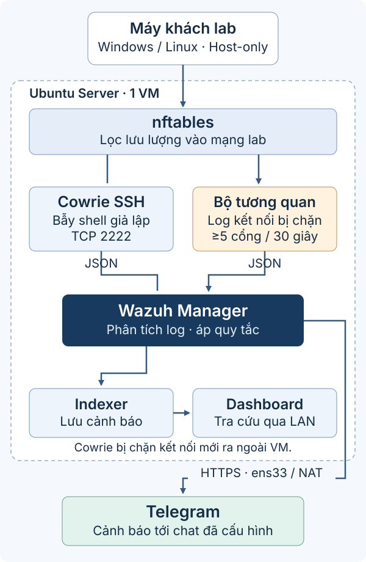

# Cowrie–Wazuh Telegram Toolkit

Bộ công cụ dựng lab bẫy SSH trên Ubuntu Server, phân tích sự kiện bằng Wazuh SIEM và gửi cảnh báo gần thời gian thực qua Telegram.



## Cách hoạt động

- Máy khách trong mạng lab kết nối tới Cowrie. Bẫy SSH cung cấp shell giả lập và ghi sự kiện JSON.
- nftables lọc lưu lượng vào VM. Bộ tương quan đọc log TCP bị chặn và nhận diện ít nhất 5 cổng đích khác nhau từ cùng nguồn trong 30 giây.
- Wazuh Manager đọc log Cowrie và JSON của bộ tương quan. Indexer lưu cảnh báo để tra cứu trên Wazuh Dashboard.
- Wazuh Integrator gọi script Python gửi bản tin HTML tới chat Telegram đã cấu hình. Tin gồm thời gian, IP nguồn và mã phiên hoặc mã sự kiện. Mật khẩu, nội dung lệnh và URL tải tệp được loại khỏi tin gửi.

| Rule | Sự kiện |
|---|---|
| `100110` | Đăng nhập SSH thành công vào bẫy |
| `100112` | 5 lần đăng nhập SSH thất bại cùng nguồn trong 60 giây |
| `100115` | Lệnh hoặc hoạt động tải tệp trong shell giả lập |
| `100120` | Dấu hiệu dò nhiều cổng trên WAN mô phỏng |

Bot gửi cảnh báo tự động. Wazuh Dashboard phục vụ tìm kiếm log. Thư mục `ui/` chứa trang minh họa với dữ liệu cố định.

## Yêu cầu

Cấu hình đã kiểm là Ubuntu Server 24.04 LTS x86-64, 4 vCPU, 8 GiB RAM và đĩa 70 GB. Chuẩn bị Internet để tải gói cài và gửi Telegram.

Sử dụng một VM chuyên dụng với hai card mạng. Cấu hình mẫu dùng các giá trị sau.

| Thành phần | Giá trị mẫu |
|---|---|
| Card NAT ra Internet | `ens33`, DHCP IPv4 và default gateway |
| Card Host-only phục vụ lab | `ens37`, `192.168.100.20/24` |
| Máy Windows quản trị | `192.168.100.1/24`, adapter Host-only để trống gateway |
| Cowrie SSH | `192.168.100.20:2222` |
| Dashboard | `https://192.168.100.20` |
| Wazuh API và Indexer | Chỉ lắng nghe trên localhost |

Dùng `ip -br addr` và `ip route` để đối chiếu. Khi đổi subnet hoặc tên card, cập nhật đồng thời `infra/90-cowrie-lab.yaml`, `infra/nftables.conf`, `cowrie/cowrie.cfg`, `wazuh/firewall/firewall.py` và địa chỉ bind Dashboard.

Giữ mạng lab cô lập, dùng tài khoản thử nghiệm riêng và chụp snapshot trước khi áp firewall. Các dịch vụ cùng dùng kernel của VM.

## Tải bộ công cụ

Cài các gói hệ thống trước, áp dụng cho cả hai cách tải.

~~~sh
sudo apt-get update
sudo apt-get install -y git curl ca-certificates python3-venv nftables openssl
~~~

Tải archive và `SHA256SUMS` từ [GitHub Releases](https://github.com/phTrKi3n/honeypot-wazuh-telegram/releases), kiểm checksum rồi giải nén. Nếu chọn archive, tải file tar.gz cùng SHA256SUMS vào một thư mục, rồi chạy.

~~~sh
sha256sum --ignore-missing -c SHA256SUMS
tar -xzf cowrie-wazuh-telegram-v0.1.0.tar.gz
cd cowrie-wazuh-telegram-v0.1.0
~~~

Để clone repo:

```sh
git clone https://github.com/phTrKi3n/honeypot-wazuh-telegram.git
cd honeypot-wazuh-telegram
```

Các bước dưới đây cài từng thành phần từ cấu hình có sẵn.

## 1. Mạng và firewall

Thực hiện các bước mạng qua console VM. Firewall mẫu thay toàn bộ ruleset hiện tại và chặn cổng OpenSSH quản trị. Đặt card NAT, Host-only trong phần mềm ảo hóa; giữ DHCP cho NAT trong cấu hình Ubuntu.

```sh
sudo install -m 0600 infra/90-cowrie-lab.yaml /etc/netplan/90-cowrie-lab.yaml
sudo netplan try
ip -4 route show default
getent passwd cowrie >/dev/null ||
  sudo useradd --system --user-group --home-dir /var/lib/cowrie --shell /usr/sbin/nologin cowrie
sudo install -d -o cowrie -g cowrie -m 0750 /var/lib/cowrie

cowrie_uid=$(id -u cowrie) || exit 1
rendered=$(mktemp) || exit 1
trap 'rm -f "$rendered"' EXIT
sed "s/@COWRIE_UID@/$cowrie_uid/g" infra/nftables.conf > "$rendered" || exit 1
sudo nft -c -f "$rendered" || exit 1
sudo cp -an /etc/nftables.conf /etc/nftables.conf.before-cowrie
sudo install -m 0755 "$rendered" /etc/nftables.conf
sudo systemctl enable nftables
sudo systemctl restart nftables
printf '%s\n' 'net.ipv4.ip_forward = 0' 'net.ipv6.conf.all.forwarding = 0' |
  sudo tee /etc/sysctl.d/90-cowrie-lab.conf >/dev/null
sudo sysctl -p /etc/sysctl.d/90-cowrie-lab.conf
```

Output của UID Cowrie chỉ được trả lời phiên SSH đã cho phép. Các kết nối mới do UID này khởi tạo, gồm qua NAT, loopback và IPv6, bị chặn.

## 2. Cowrie

```sh
sudo python3 -m venv /opt/cowrie/venv
sudo /opt/cowrie/venv/bin/pip install 'cowrie==3.1.6'
(cd /var/lib/cowrie && sudo -u cowrie /opt/cowrie/venv/bin/cowrie init)
sudo install -o root -g cowrie -m 0640 cowrie/cowrie.cfg /var/lib/cowrie/etc/cowrie.cfg
sudo bash -euc '
  f=/var/lib/cowrie/etc/userdb.txt
  if [ ! -f "$f" ]; then
    umask 077
    printf "labdemo:x:%s\n" "$(openssl rand -hex 16)" > "$f"
  fi
  chown root:cowrie "$f"
  chmod 0640 "$f"
'
sudo install -m 0644 cowrie/cowrie-lab.service /etc/systemd/system/cowrie-lab.service
sudo systemctl daemon-reload
sudo systemctl enable --now cowrie-lab
sudo ss -ltn 'sport = :2222'
```

Tài khoản quản trị dùng quyền root để xem `userdb.txt` khi đăng nhập thử. Giữ file này ngoài Git và ảnh báo cáo. Cowrie chạy dưới tài khoản riêng với sandbox systemd.

## 3. Wazuh SIEM

Đã kiểm với Wazuh 4.14.10. URL dưới đây thuộc dòng 4.14, có thể phục vụ bản vá mới hơn. Kiểm phiên bản sau cài và chạy lại các phép kiểm.

```sh
sudo install -d -m 0700 /root/wazuh-setup
sudo curl --fail --show-error --location \
  https://packages.wazuh.com/4.14/wazuh-install.sh \
  -o /root/wazuh-setup/wazuh-install.sh
sudo bash -c 'cd /root/wazuh-setup && bash wazuh-install.sh -a'
dpkg-query -W wazuh-manager wazuh-indexer wazuh-dashboard filebeat
```

Giữ gói tài khoản do installer tạo tại `/root/wazuh-setup`, ngoài repo.

Cấu hình địa chỉ lắng nghe trước khi sử dụng.

- `/var/ossec/api/configuration/api.yaml` — `host: ['127.0.0.1']`.
- `/etc/wazuh-indexer/opensearch.yml` — `network.host: "127.0.0.1"`.
- `/etc/wazuh-dashboard/opensearch_dashboards.yml` — `server.host: 192.168.100.20`.

```sh
sudo install -d -m 0755 /etc/systemd/system/wazuh-dashboard.service.d
printf '[Unit]\nWants=network-online.target\nAfter=network-online.target\n' |
  sudo tee /etc/systemd/system/wazuh-dashboard.service.d/network.conf >/dev/null
```

Xem [Wazuh Quickstart](https://documentation.wazuh.com/current/quickstart.html) cho yêu cầu upstream. Dashboard sử dụng chứng chỉ do bộ cài tạo; cấu hình chứng chỉ phù hợp địa chỉ truy cập khi triển khai cho người khác.

## 4. Thu log và áp rule

```sh
sudo install -d -m 0755 /usr/local/lib/cowrie-lab
sudo install -m 0644 wazuh/firewall/firewall.py /usr/local/lib/cowrie-lab/firewall.py
sudo install -d -m 0750 /var/log/cowrie-lab
sudo touch /var/log/cowrie-lab/firewall.json
sudo chmod 0640 /var/log/cowrie-lab/firewall.json
sudo install -m 0644 wazuh/firewall/cowrie-firewall-events.service \
  /etc/systemd/system/cowrie-firewall-events.service
sudo install -o root -g wazuh -m 0640 wazuh/rules/cowrie_lab.xml \
  /var/ossec/etc/rules/cowrie_lab.xml
sudo cp -an /var/ossec/etc/ossec.conf /var/ossec/etc/ossec.conf.before-cowrie
```

Chép hai khối `localfile` từ `wazuh/localfiles.xml` vào một khối `ossec_config` hiện có trong `/var/ossec/etc/ossec.conf`. Mỗi đường dẫn chỉ xuất hiện một lần.

```sh
sudo /var/ossec/bin/wazuh-analysisd -t
sudo /var/ossec/bin/wazuh-logcollector -t
sudo systemctl daemon-reload
sudo systemctl enable --now cowrie-firewall-events
sudo systemctl restart wazuh-manager wazuh-indexer wazuh-dashboard
```

Khi xoay `firewall.json` bằng cách đổi tên file, khởi động lại bộ gom để mở file mới.

## 5. Telegram

1. Tạo bot qua [BotFather](https://t.me/BotFather), lấy token, mở chat riêng với bot và gửi `/start`.
2. Lấy ID chat theo trường `message.chat.id` từ [Telegram getUpdates](https://core.telegram.org/bots/api#getupdates). Giữ token trong cấu hình cục bộ.
3. Tạo file thật từ mẫu rồi sửa token và chat ID trên Ubuntu.

```sh
sudo test -f /var/ossec/etc/cowrie-telegram.json ||
  sudo install -o root -g wazuh -m 0640 wazuh/telegram/config.example.json \
    /var/ossec/etc/cowrie-telegram.json
sudo nano /var/ossec/etc/cowrie-telegram.json
sudo chown root:wazuh /var/ossec/etc/cowrie-telegram.json
sudo chmod 0640 /var/ossec/etc/cowrie-telegram.json
sudo install -o root -g wazuh -m 0750 wazuh/telegram/custom-cowrie-telegram \
  /var/ossec/integrations/custom-cowrie-telegram
```

Chép khối `integration` từ `wazuh/telegram/integration.xml` vào một khối `ossec_config` trong `/var/ossec/etc/ossec.conf`. Giữ một cấu hình tích hợp cho `custom-cowrie-telegram`.

```sh
sudo /var/ossec/bin/wazuh-integratord -t
sudo systemctl restart wazuh-manager
sudo /var/ossec/bin/wazuh-control status
sudo journalctl -t cowrie-telegram -o cat
```

## Kiểm thử và sử dụng

```sh
python3 wazuh/telegram/test_telegram.py
python3 wazuh/firewall/firewall.py --check
sudo systemctl is-active nftables cowrie-lab cowrie-firewall-events \
  wazuh-manager wazuh-indexer wazuh-dashboard filebeat
timedatectl show -p NTPSynchronized
sudo ss -ltn
```

Từ máy khách lab, đăng nhập tới `192.168.100.20` cổng `2222` bằng tài khoản bẫy. Đối chiếu mã phiên trên Cowrie, Wazuh và Telegram.

| Dữ liệu | Vị trí |
|---|---|
| Cowrie | `/var/lib/cowrie/var/log/cowrie/cowrie.json` |
| Firewall tổng hợp | `/var/log/cowrie-lab/firewall.json` |
| Cảnh báo Wazuh | `/var/ossec/logs/alerts/alerts.json` |
| Kết quả gửi Telegram | `journalctl -t cowrie-telegram` |

Một kết nối bị chặn có thể tạo log `LAB_WAN_BLOCK`. Rule `100120` cần đủ ngưỡng tương quan. Dữ liệu mẫu ở `wazuh/fixtures/` dùng cho các ca biên; gắn `fixture: true` cho bản ghi thử khi gửi Telegram để có nhãn `[MẪU KIỂM THỬ]`.

Độ trễ ghi trong nhật ký kết thúc khi Bot API trả `ok`. Log nội bộ Cowrie/Wazuh có thể chứa dữ liệu nhập vào bẫy. Giới hạn quyền đọc, thời gian lưu và dùng thông tin đăng nhập thử riêng.

## Docker

Docker đóng gói bộ tương quan và định dạng bản tin để chạy kiểm thử offline.

```sh
docker compose -f docker/compose.yaml up --build \
  --abort-on-container-exit --exit-code-from soc-detector
```

Container dùng UID thấp, filesystem chỉ đọc, bỏ capabilities và tắt mạng. Dùng nguyên thư mục fixtures đi cùng repo. Self-test hiện bỏ qua file fixture bị thiếu; xác nhận output có đủ bốn dòng `SOC ALERT` cho các rule đã liệt kê.

## Phạm vi bản phát hành

Bản này dành cho lab phòng thủ một VM. Phiên SSH thật, chặn mạng, rule Wazuh và gửi Telegram đã được kiểm trên cấu hình nêu trên. Phần dò nhiều cổng được kiểm bằng log tổng hợp và fixture. Khi dựng VM mới, chạy lại nghiệm thu theo môi trường thực tế.

Cowrie và Wazuh dùng chung kernel. Giữ Dashboard ở mạng quản trị và token, mật khẩu, khóa riêng, log thô cùng ảnh đĩa ngoài repo.

Ảnh kiến trúc được dựng bằng Graphify từ các kết nối đã đối chiếu trong code. Các thư mục để tùy chỉnh là `infra/`, `cowrie/`, `wazuh/` và `docker/`.